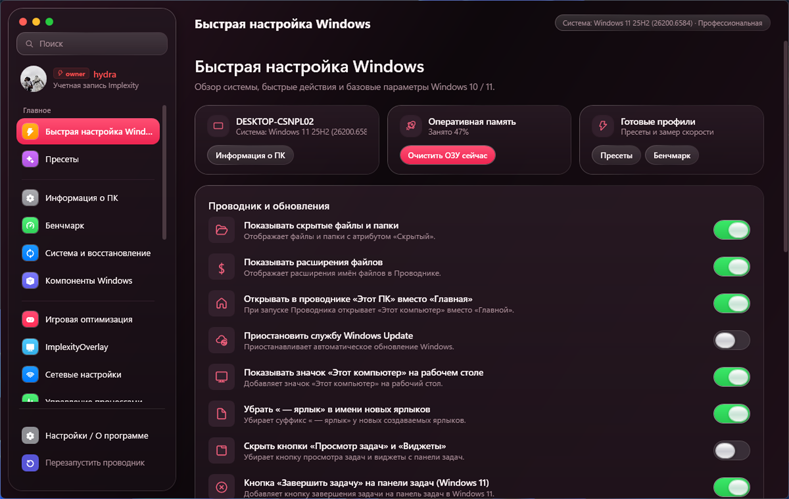

# ⚡ Implexity Tweaker

  
  
  

**Implexity Tweaker** — современный инструмент для тонкой настройки, оптимизации, мониторинга и диагностики **Windows 10 и Windows 11**. Приложение написано на **C# / .NET 8 (WPF)** с интерфейсом **WPF-UI**, поддерживает **2 стиля оформления** (**Apple** — по умолчанию, и **Windows Fluent**), **10 тем** (`Тёмный графит`, `Светлое стекло`, `Полуночный индиго`, `Природный титан`, `Динамический розовый`, `Implexity`, `Aurora`, `Graphite`, `Light`, `Cream`), **5 языков** (русский, английский, украинский, немецкий, словацкий), глобальный поиск (`Ctrl+K`) и фоновый режим в системном трее.

---

## 📸 Интерфейс программы

  

---

## ✨ Модули и возможности (v2.0.0)

Навигация разделена на логические категории в боковой панели:

### 🏠 Главное
* **Быстрая настройка Windows:** мгновенное применение базовых твиков — показ скрытых файлов и расширений, открытие Проводника на «Этот ПК», пауза Windows Update, значок «Этот ПК» на рабочем столе, удаление суффикса «— ярлык», скрытие виджетов/поиска, снижение рекламы, отключение залипания клавиш, Game Mode, отключение парковки ядер и создание снимка-страховки.
* **Пресеты:** 9 готовых наборов с оценкой уровня риска (`Safe` / `Moderate`) и проверкой совместимости со сборкой Windows (*Игровой ПК*, *Низкая задержка сети*, *Приватность и без рекламы*, *Проводник и контекстное меню*, *Отзывчивый интерфейс*, *Обслуживание системы*, *Включение/выключение защиты*, *Сброс настроек*).

### 🖥️ Система
* **Информация о ПК:** сводка комплектующих, живой мониторинг CPU, GPU, ОЗУ, диска и сети, температуры, отчёт о батарее и окно оценки здоровья накопителей по SMART.
* **Бенчмарк:** встроенный тест производительности (CPU 1 ядро / все ядра, память, чтение/запись диска 128 МБ, время загрузки Windows), расчёт **Индекса Implexity**, история прогонов и генерация PNG-карточки результатов в буфер обмена.
* **Система и восстановление:**
  * Создание и откат полных снимков системы (реестр, службы, задачи планировщика, `hosts`, схема питания, резервная копия BCD, настройки).
  * Системная диагностика (`DISM /CheckHealth`, `/ScanHealth`, `sfc /scannow`, `chkdsk`, `bcdedit`, проблемные устройства, точки восстановления).
  * Управление гибернацией (`hiberfil.sys`), файлом подкачки (`pagefile.sys`) и очистка кэша шейдеров / хранилища.
  * **Телеметрия и приватность:** отключение служб и политик телеметрии, а также обратимая блокировка доменов телеметрии в файле `hosts`.
* **Компоненты Windows:** установка DirectPlay, .NET Framework 2.0/3.0/3.5, включение классического Просмотрщика фотографий Windows.

### ⚡ Производительность и сеть
* **Игровая оптимизация:** FSO, MPO, Game DVR, Game Mode, HAGS, схема питания Ultimate Performance, управление парковкой ядер, приоритеты процессов, `1:1 Raw Input` (MarkC Fix), размер буфера ввода, высокоточный таймер `0.5 мс` (`NtSetTimerResolution`), запрет энергосбережения USB-мыши, приоритет `csrss.exe`, Dynamic Tick, `Win32PrioritySeparation`, а также **MSI-режим и Interrupt Affinity** для PCI-устройств.
* **ImplexityOverlay:** внутриигровой оверлей без инъекции DLL. Замер **FPS, Frametime и 1% Low** напрямую через **ETW** (`DXGI`, `D3D9`, `DxgKrnl`), чтение GPU через **NVIDIA NVML** и WMI, 4 визуальных стиля (`Classic`, `TelemetryText`, `RoundedGlass`, `GamingBars`), график фреймрейта, загрузка по ядрам и горячая клавиша переключения (`F9` по умолчанию).
* **Сетевые настройки:** быстрая смена DNS (Cloudflare, Google, Quad9, AdGuard DNS, OpenDNS, Xbox DNS, сброс DHCP), отключение алгоритма Nagle (`TcpNoDelay`), `TcpAckFrequency`, Auto-Tuning и сетевые инструменты.
* **Управление процессами:** фоновый наблюдатель (`ProcessPriorityWatcher`) для авто-приоритета и привязки к физическим ядрам, а также очистка ОЗУ через `EmptyWorkingSet` (вручную, по порогу загрузки или при запуске игр).
* **Автозагрузка:** менеджер и аудит подозрительных записей автозапуска.

### 🎨 Оформление
* **Проводник и Рабочий стол:** настройка отображения файлов и стартового вида.
* **Персонализация:** тёмная тема, прозрачность, кнопка «Завершить задачу» в панели задач (Windows 11 22H2+), компактные кнопки, отключение размытия экрана блокировки, отключение лого/анимации загрузки.
* **Контекстное меню:** возврат классического меню Windows 10 в Windows 11, удаление задержки открытия, пункт «Открыть в терминале» и дополнительные параметры.
* **Фановые настройки:** временная смена отображаемого названия процессора в системе, фейковый BSOD, поворот экрана на 180° и текст при входе в Windows.

### 🛡️ Защита и ПО
* **Безопасность:** управление Защитником Windows, SmartScreen, UAC, брандмауэром и приложением «Безопасность Windows».
* **Windows Update:** управление службами и политиками обновлений.
* **Удаление UWP-приложений:** удаление встроенных приложений Microsoft Store для текущего пользователя.

### 🧰 Утилиты и настройки
* **Установка приложений:** установка популярного ПО (Chrome, 7-Zip, VLC, VS Code, Firefox, Steam, Discord, Telegram, Spotify) и произвольных пакетов через `winget`, а также `winget upgrade --all`.
* **Активация Windows:** KMS-активация поддерживаемых редакций Windows через `slmgr.vbs`.
* **Таймер выключения:** отложенное выключение, перезагрузка или отмена таймера.
* **Настройки и профиль:** выбор стиля дизайна (`Apple` / `Windows`), темы и языка, импорт/экспорт/публикация конфигов `.implexity` (v2), вход в аккаунт `implexity.fun`, проверка обновлений на GitHub.

---

## 🚀 Как использовать

> **⚠️ ВАЖНО:** Все изменения реестра, служб, загрузчика и системных настроек вы выполняете на свой страх и риск. Перед применением твиков обязательно создайте **снимок системы** в разделе «Система и восстановление» или **точку восстановления Windows**.

1. Скачайте последнюю версию из раздела [Releases](https://github.com/0kar1d3/ImplexityTweaker/releases).
2. Запустите исполняемый файл **от имени администратора**.
3. Выберите готовый **Пресет** или перейдите в нужный раздел (либо воспользуйтесь поиском `Ctrl+K`).
4. При использовании фоновых функций (оверлей, авто-приоритет, автоочистка ОЗУ) приложение может сворачиваться в системный трей и запускаться с флагом `--minimized`.

---

## 🛠 Технологии и требования

* **Стек:** C# / .NET 8 (`net8.0-windows10.0.19041.0`), WPF, [WPF-UI](https://github.com/lepoco/wpfui) 2.1.0, `System.Management`, Win32 API (ETW, NVML, `NtSetTimerResolution`, `EmptyWorkingSet`).
* **ОС:** Windows 10 / Windows 11 (x64, минимальная сборка 17763).
* **Права:** требуются права администратора (`requireAdministrator`).

---

## 📜 Дисклеймер

Автор не несет ответственности за возможные сбои в работе операционной системы, потерю данных или некорректную работу оборудования (в том числе при изменении параметров загрузчика BCD, режима MSI / Interrupt Affinity, отключении файла подкачки, гибернации или компонентов безопасности). Используйте инструмент осознанно.

---

Поддержите автора — поставьте <b>Star ⭐</b> на GitHub!

